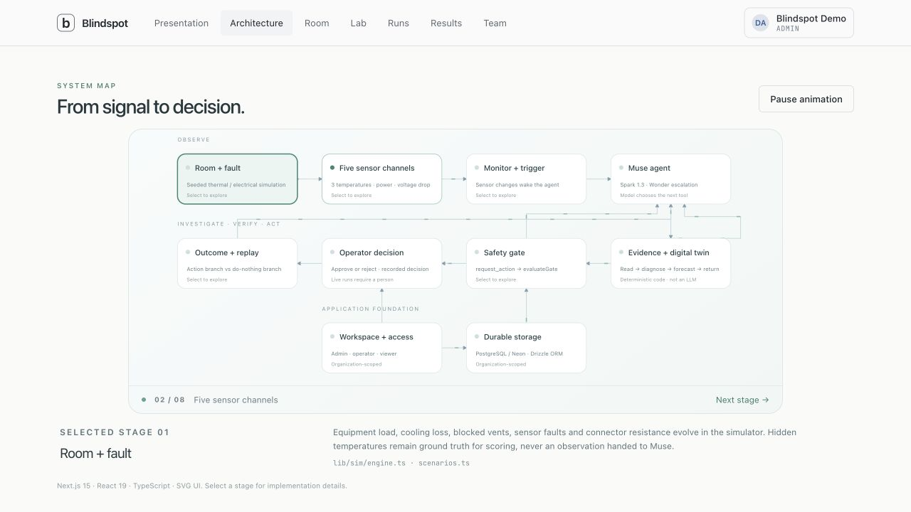
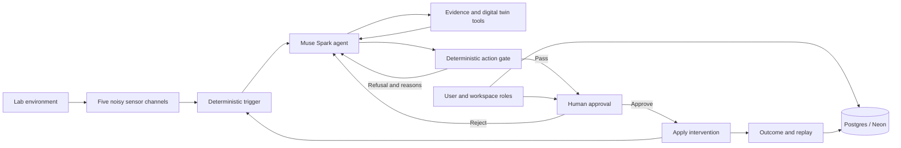

# Blindspot

**A live Muse monitoring agent that investigates what a few sensors cannot directly see.** Built for the Meta Global AI Developer Hackathon, Indie track, “Push the Frontier.”

Blindspot combines sparse sensor readings, a physical digital twin, an estimator, a tool-using Muse agent, a deterministic action gate and human approval. The agent is live: it makes real Meta API calls and chooses its next tools. Its lab and sensor inputs are software-generated; no physical equipment is connected and the project does not demonstrate real-world fire prevention.



The interactive, animated version is available at `/architecture` after signing in.

## Start here

```bash
npm install
cp .env.example .env.local
# Configure auth and the model connection, then:
npm run dev
```

Open `http://localhost:3000`. Sign up, create a workspace, and open Lab. Without `DATABASE_URL`, embedded Postgres (PGlite) stores data in `.data/pglite`; migrations run automatically. With a Postgres/Neon connection string, the app uses that database instead. Keep credentials in ignored `.env.local`.

For prepared local demo accounts, run `npm run demo:setup` while the server is running, then restart it. The sign-in page offers Demo Admin, Demo Operator and Demo Viewer. Credentials remain in ignored local configuration; shortcuts are localhost-only. Disable them with `BLINDSPOT_DEMO_LOGIN=false`. Signing in never automatically approves an action.

## Demo walkthrough

Follow the navigation from left to right:

| Tab | What to show |
|---|---|
| **Presentation** | Three slides: the problem, the sparse-sensor idea, and the reviewed-response solution. Real incident photographs, diagrams, attributed preliminary figures, keyboard navigation and Present/fullscreen mode. |
| **Architecture** | One animated, selectable map of sensors, triggers, Muse, tools, gate, operator, outcomes, access controls and database. Pause motion or select a node to explain its implementation. This walkthrough itself makes no model calls. |
| **Room** | An interactive room layout with racks, desk rows, UPS, cooling and all five sensor placements. Highlight the unmeasured zones. The layout is illustrative, not installation guidance. |
| **Lab** | Choose a fault scenario and reproducible seed, then start a live Muse investigation. Watch the workflow graph beside real event logs. Review each action and approve or reject it. The sensor timeline below restores independent scenario playback, air/connector/electrical graphs, speed controls and a time scrubber. |
| **Runs** | Workspace-owned live runs and preserved Muse recordings. Open a completed run to inspect its trace, decisions and outcome. |
| **Results** | Detection, interventions, remaining breaches, model/tool usage, and the separate targeted research regression. |
| **Team** | Admin-managed workspace membership and admin/operator/viewer roles. |

Incident photographs are served locally. Presentation source credits are plain text; detailed provenance, research URLs and reuse limitations are in [docs/DEMO-SOURCES.md](docs/DEMO-SOURCES.md). Jadavpur and Bengaluru reports motivate investigation; they do not establish that Blindspot could have prevented those incidents. The Bengaluru report concerns solvents, outside the electrical fault model. Global data-centre electricity figures are context, not global laboratory-fire statistics.

## Architecture



**Stack:** Next.js 15 App Router, React 19, TypeScript, Tailwind CSS 4, SVG diagrams and Recharts; Better Auth organizations; Drizzle ORM over Neon/Postgres or local PGlite; Zod validation; Vitest. The `openai` npm client talks to the **Meta Model API**, not an OpenAI model. There is no external agent framework: the tool loop is implemented directly in TypeScript.

**Models:** `muse-spark-1.3` performs live investigations. `muse-wonder-1.0` is configured escalation after repeated gate refusals, rather than a model called on every step. The ridge regression estimator and physical fault fitting are deterministic code, not additional language models. Voice, image and segmentation models are not part of the core monitoring loop.

## What happens during a run

1. A `(scenario, seed)` produces reproducible equipment loads, faults and noisy readings. Samples represent 30-second intervals. The agent does not receive future readings or simulator ground truth.
2. The trigger calibrates initial healthy offsets, then checks residuals, high-resistance electrical signatures, frozen sensors and high hidden-zone estimates. A trigger wakes Muse; there is no continuous model polling.
3. Muse chooses evidence tools, checks sensor reliability, estimates unmeasured temperatures and fits competing fault hypotheses with `diagnose`.
4. It calls `simulate_action` on distinct candidate actions. These forecasts come from a nominal physical twin, which can be wrong.
5. `request_action` invokes an independent gate. Rejected proposals return reasons to Muse. A model cannot override this code.
6. A passing proposal pauses the run for a permitted human to approve or reject. Approval affects the modeled environment; no physical actuator exists.
7. The monitor observes the response and can investigate again using prior context and interventions. It allows up to six bounded investigations, with cooldowns and evidence-change checks.
8. Completed runs store the actual messages, calls, results, gate decisions, approvals, token usage and outcome in the workspace database. Replay compares the intervention branch with the same scenario without action.

### Sensors and blind spots

| Channel | Observation |
|---|---|
| S1 | Rack A inlet air temperature |
| S2 | Desk row 1 air temperature |
| S3 | Cooling return-air temperature |
| M1 | UPS total power |
| M2 | Rack B power-strip voltage drop |

Rack B temperature, desk row 2 temperature and the UPS connector temperature are hidden. Sensor noise, bias and frozen readings make “all visible readings look normal” an insufficient conclusion.

Seven scenario families are available: cooling failure, blocked vent, load spike, loose connection, stuck sensor, unattended cooling loss, and a no-fault control. The software thresholds are scoring limits inside this model, not certified equipment safety limits.

### Tools and decisions

| Tool | Purpose |
|---|---|
| `list_sensors`, `get_reading`, `get_history` | Discover channels and inspect current/past observations |
| `sensor_metadata` | Check noise, calibration and flat-reading suspicion |
| `estimate_hidden_zones` | Ridge estimates and uncertainty for unmeasured temperatures |
| `diagnose` | Fit competing faults, report adequacy, excluded sensors and coverage limitations |
| `simulate_action` | Forecast candidate interventions against doing nothing |
| `request_action` | Submit a proposal to the deterministic gate and approval flow |
| `notify` | Record an alert without applying an intervention |

Actions include rack power caps, shedding noncritical load, backup cooling, vent clearing, technician inspection and last-resort circuit disconnection. Every action has a validated schema. The gate checks catalog membership, bounded forecast horizon, prior comparison of distinct candidates, critical-load protection, adequacy, plausible hazard, robust improvement and absence of new hazards. Circuit disconnection has additional imminent-breach and last-resort requirements. Inspection has action-specific warrant checks. Passing the gate is not equivalent to human approval.

## Research improvements and measured results

The agent now retains compact investigation context, revisits unresolved warnings, avoids repeated unchanged frozen-sensor inspections, and schedules follow-ups from observed changes. The connector twin fits both steady and accelerating resistance growth. Diagnosis distinguishes fault-model weights from calibrated breach probabilities and explicitly reports lost coverage.

An empirical forecast allowance was built offline on separate calibration scenarios. Its held-out coverage was **12/14 (85.7%)**, below the 90% target. It is limited to untreated forecast windows and is omitted after interventions. It is evidence of uncertainty, not a safety guarantee. See [docs/RESEARCH.md](docs/RESEARCH.md).

| Evaluation | Result | Scope |
|---|---|---|
| Original Spark subset | 15/18 expected breaches detected early; 12/18 avoided; 0/2 no-fault controls alerted | 20 reused benchmark seeds; automated evaluation approvals |
| Targeted research regression | All four expected breaches avoided; **one unnecessary inspection on the single control** | Five deliberately selected cases; automated evaluation approvals; not a blind benchmark |

The targeted batch cost approximately $0.78; the original subset cost approximately $2.42. These are measured usage, not demonstration instructions. Inspection outcomes depend on the simulator's repair assumptions. Earlier recordings remain intact: the original `unattended_ac-3000-llm` run delayed a breach by about 35 minutes and reduced above-limit exposure by 86%; it did not prevent it.

Historical deterministic benchmark data remains for reproducibility. Its rule-based policy is not Muse, and its numbers must never be presented as LLM performance. The current demo focuses on actual Muse runs. A shared physical model between twin and environment also makes the experiments more optimistic than real deployment.

## Accounts, storage and reliability

- **Admin:** manage workspace members and roles, start runs, approve actions.
- **Operator:** start runs and approve actions.
- **Viewer:** read runs/results; cannot start or approve.
- Server-side permissions and workspace ownership protect APIs; hiding a button is not the security boundary. The last admin cannot be removed or demoted.
- Completed runs are workspace-owned JSONB records in Postgres. Bundled Muse recordings are shared reference data.
- Active sessions checkpoint locally in `.data/live`; local execution leases and saved replies support recovery without repeating completed paid calls. Uncertain in-flight billing stops recovery for review.
- Browser polling is serialized, stale replies are ignored, and approval buttons prevent duplicate submissions. Navigation immediately indicates loading and avoids prefetching every database-backed page.
- Model calls retain server-side spending controls, usage accounting and bounded retries. Removing budget labels from the demo does not remove these controls. Public live inference remains disabled on Vercel.

## Configuration and commands

Configure these locally; never commit credentials:

| Variable | Purpose |
|---|---|
| `MODEL_API_KEY`, `MODEL_BASE_URL` | Meta credentials and API endpoint |
| `MODEL_DEFAULT`, `MODEL_ESCALATE` | Default and escalation model IDs |
| `BETTER_AUTH_SECRET`, `BETTER_AUTH_URL` | Auth signing secret and local application URL |
| `DATABASE_URL` | Neon/Postgres connection string; omit for PGlite |
| `PGLITE_DIR`, `BLINDSPOT_RUNS_DIR` | Optional local storage overrides |

Additional accounting and model options are documented in `.env.example` and [AGENTS.md](AGENTS.md).

```bash
npm test                    # Local unit/integration tests; no paid inference
npm run typecheck
npm run db:migrate          # Apply committed migrations
npm run db:generate         # Generate migration after schema changes
npm run train               # Train deterministic hidden-zone estimator
npm run calibrate:forecast  # Offline forecast calibration
npm run eval:llm            # Paid LLM evaluation; resumes saved results
npm run eval:research       # Paid targeted regression; preserves original evaluation
npm run record -- --kind loose_connection --seed 3000 --approve prompt
```

Stop the running server before `npm run build`; development and production share `.next`. Then run `npm start`. Use the normal launcher shutdown so database resources close. Never open the same PGlite data directory concurrently from another process.

## Code map and further reading

| Path | Responsibility |
|---|---|
| `app/` | Authenticated pages, live/approval/team API routes |
| `components/` | Presentation, architecture, room, live graph/logs, replay and results |
| `lib/sim/` | Seeded physical environment and sensor observations |
| `lib/agent/` | Muse loop, prompts, scheduling, recording, accounting and recovery support |
| `lib/tools/` | Validated tools, incident state and deterministic gate |
| `lib/twin/`, `lib/estimate/` | Fault fitting, forecasts, ridge estimates and forecast calibration |
| `lib/auth/`, `lib/db/`, `drizzle/` | Roles, workspace guards, database schema and migrations |
| `lib/live/` | Live sessions and checkpoint storage |
| `data/` | Validated recordings, benchmark results and trained models |
| `tests/`, `scripts/` | Verification and reproducible CLI workflows |

The detailed explanation is in [docs/PROJECT-GUIDE.md](docs/PROJECT-GUIDE.md). Verification notes: [docs/VERIFICATION.md](docs/VERIFICATION.md). Presentation/photo sources: [docs/DEMO-SOURCES.md](docs/DEMO-SOURCES.md).

Remaining work includes physical-sensor validation, broader fresh-seed evaluation, reducing unnecessary inspections, and production auth/email/hosting hardening. Wokwi is deferred. No hardware integration or real-world prevention claim is implied.
